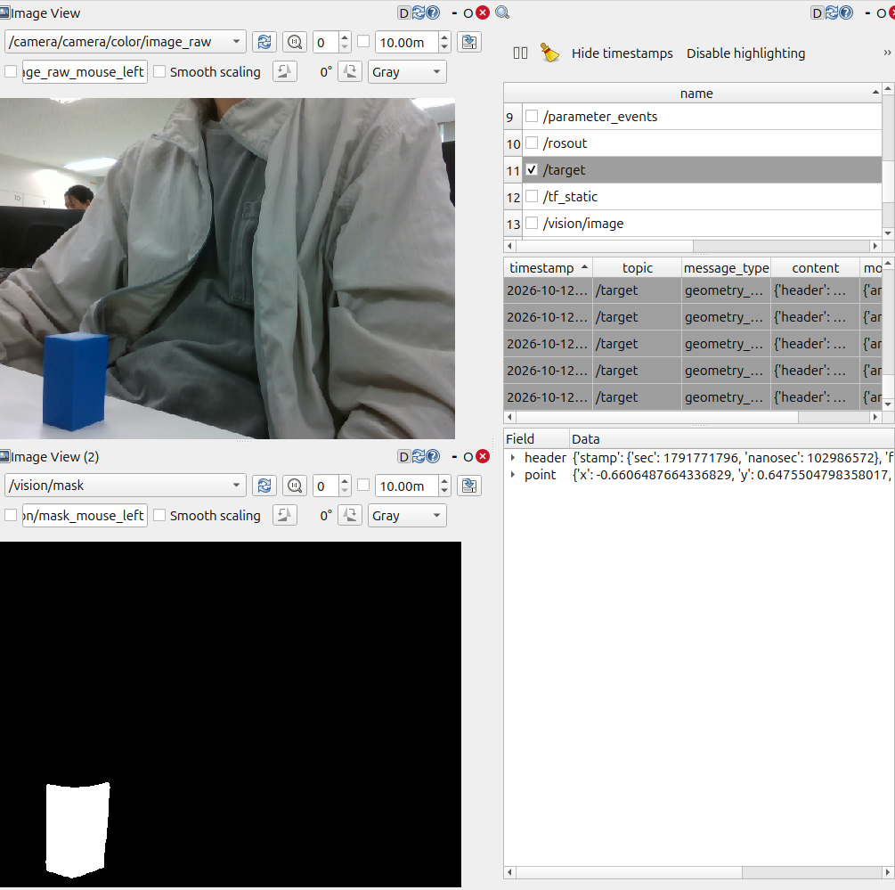
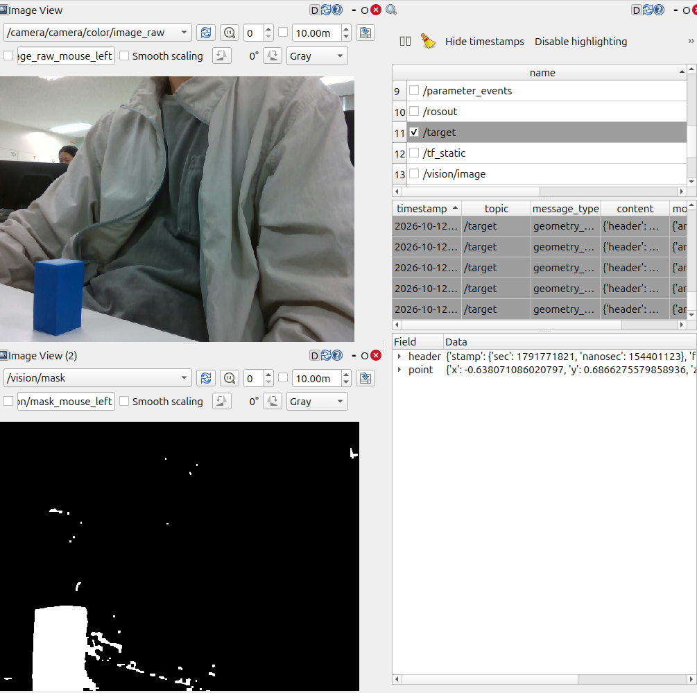
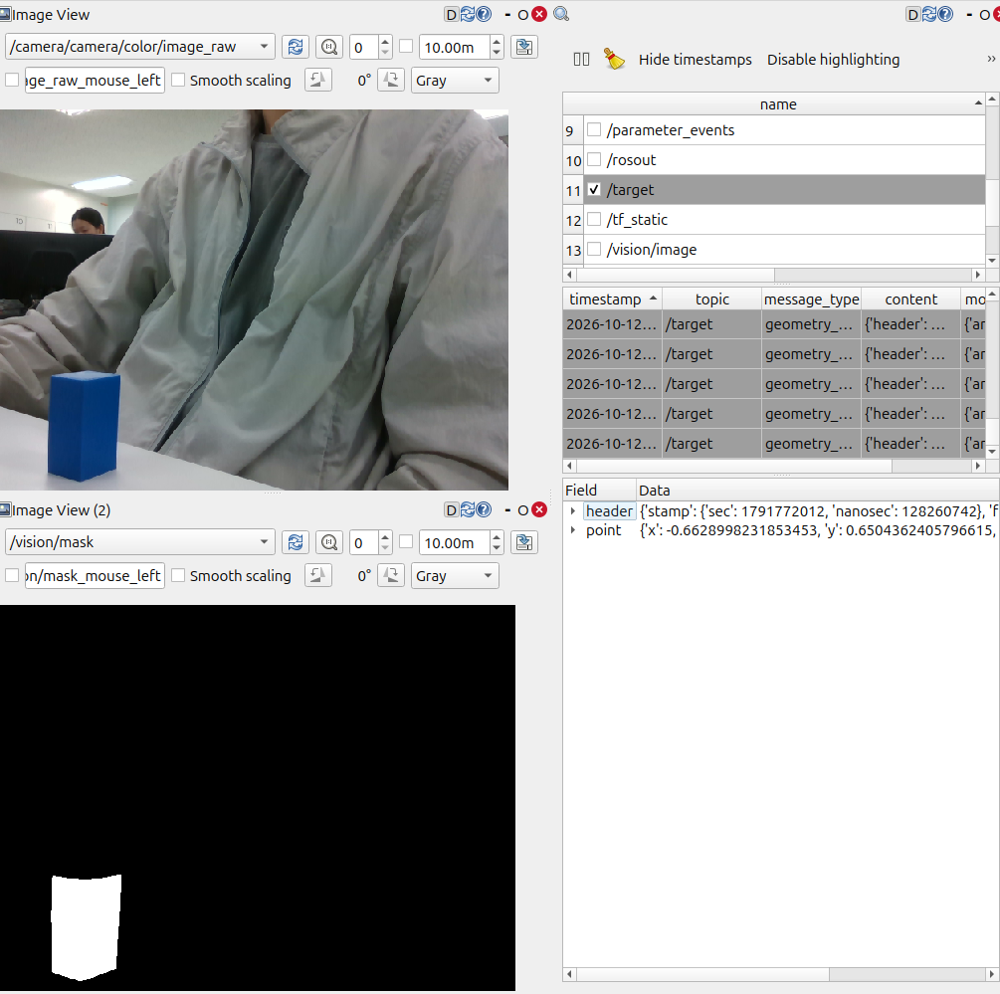
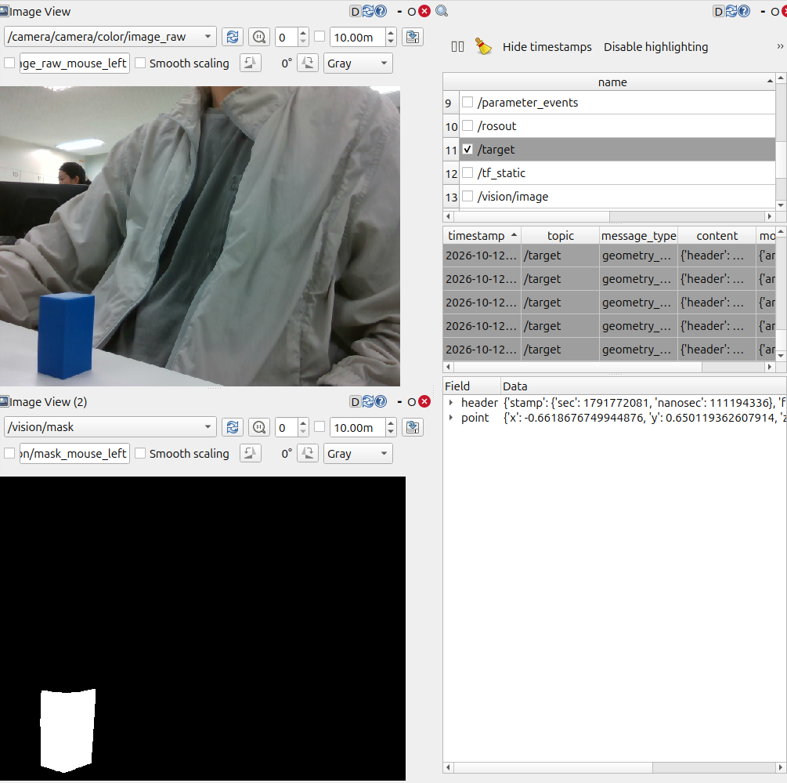
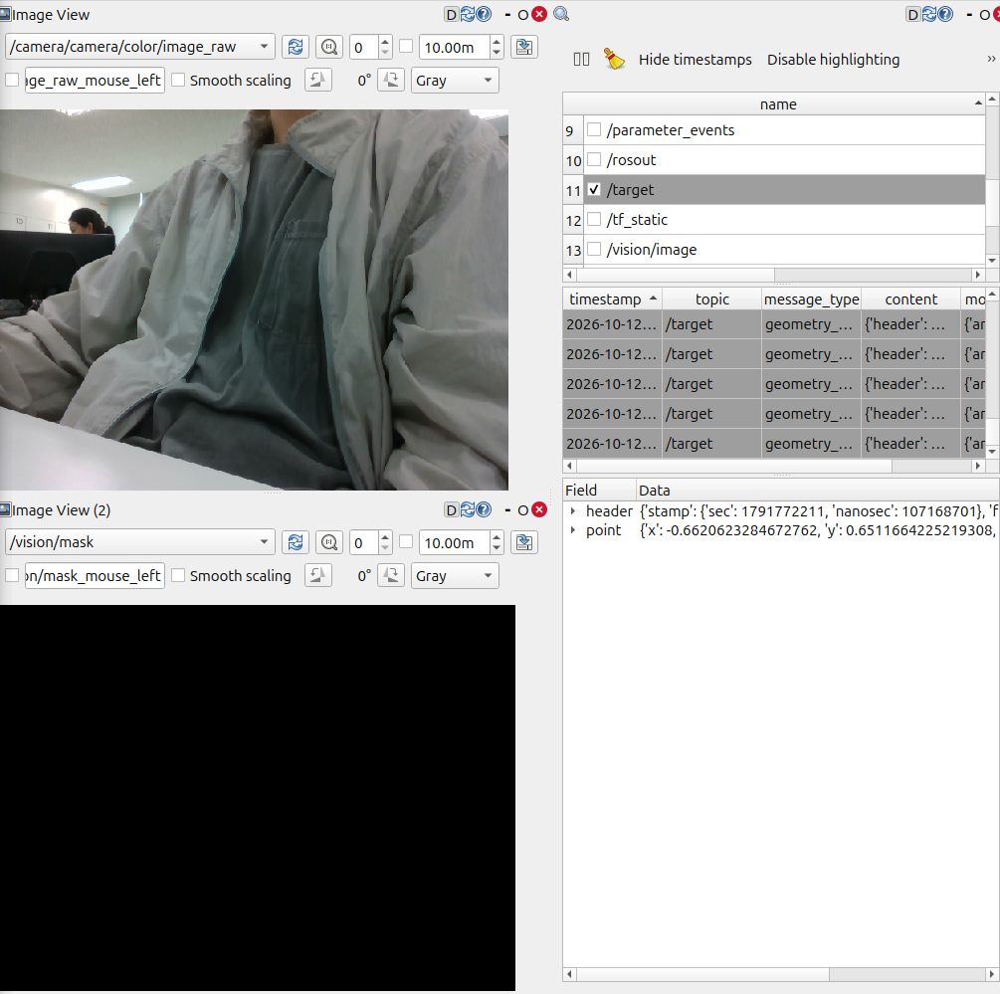
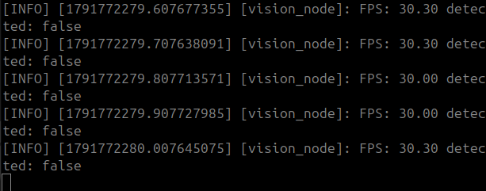

# Lv2 모듈 3 과제 보고서: 설정값에 따른 Mask와 검출 결과 변화 분석

## 1. 실행 환경과 입력

| 항목 | 내용 |
|---|---|
| 사용 코드 | `lv2_module3/ros2_ws/src/vision/src/vision_node.cpp` |
| 실행 명령 | ① `ros2 launch realsense2_camera rs_launch.py rgb_camera.color_profile:=640,480,30 enable_depth:=false align_depth.enable:=false` ② `ros2 run vision vision_node` ③ `rqt --clear-config` (Raw·Mask는 Image View, 검출 결과는 `ros2 topic echo /target`). 모터 제어 노드는 실행하지 않음 |
| ROS 2 환경 | Ubuntu 24.04.5, ROS 2 Lyrical, OpenCV 4.6.0 |
| 입력 출처 | Camera: Intel RealSense D435 실시간, color 640×480@30. 삼각대 고정, 실내 조명 100%, 책상 위 파란 직육면체 1개 |

## 2. 토픽 구성

| 자료 | 토픽 이름 | 메시지 타입 | 발행 노드 | 수신 도구 |
|---|---|---|---|---|
| Raw Image | `/camera/camera/color/image_raw` | `sensor_msgs/msg/Image` | `/camera/camera` | `rqt_image_view` |
| Mask | `/vision/mask` | `sensor_msgs/msg/Image` | `/vision_node` | `rqt_image_view` |
| 검출 결과 | `/target` | `geometry_msgs/msg/PointStamped` | `/vision_node` | `ros2 topic echo` |

토픽 목록과 발행·구독 정보: [results/01_topics.txt](results/01_topics.txt)

### Raw Image


위쪽 Image View가 Raw Image, 아래쪽이 Mask다. 해상도 640×480, `encoding` `rgb8` ([results/02_raw_info.txt](results/02_raw_info.txt)). 목표는 책상 위 왼쪽 아래의 파란 퍽, 배경은 흰 책상과 실내 공간이다. 목표 외에 파란 계열 물체는 없다.

### Mask

- 기준 설정 `lower = [98, 190, 25]`, `upper = [118, 255, 230]`에서 목표 영역만 흰색(255)이고 나머지는 검은색(0)이다. 흰색은 HSV가 `lower`~`upper` 안인 전경, 검은색은 배경이다 (`mono8`). 목표 외에 남은 영역과 누락된 부분은 없다.
- 이 Mask는 `inRange`와 `morphologyEx`(OPEN 1회, CLOSE 2회)까지 거친 결과로, `min_area` 필터보다 앞 단계의 출력이다.
- 코드 (`vision_node.cpp`): HSV 범위는 파라미터 `lower`·`upper`를 프레임마다 `get_parameter`로 읽고, Mask는 `inRange`와 `morphologyEx`로 만들어 `mask_publisher_`로 발행한다. 값은 실행 중 `ros2 param set /vision_node lower "[98, 190, 25]"`로 바꾸고 바로 적용된다.

### 검출 결과

`ros2 topic echo /target` 수신 메시지 ([results/04_target.txt](results/04_target.txt)):

```
header:
  stamp: {sec: 1791771450, nanosec: 883394775}
  frame_id: camera_color_optical_frame
point:
  x: -0.6622633912072036
  y: 0.6484235180145369
  z: 0.032294921875
```

| 필드 | 의미 | 단위 |
|---|---|---|
| `header.stamp` | 처리한 원본 프레임의 촬영 시각 | 초·나노초 |
| `point.x` | 최대 컨투어 무게중심의 가로 오차. 중앙 0, 왼쪽 끝 -1, 오른쪽 끝 +1 | 정규화(-1~1) |
| `point.y` | 같은 세로 오차. 위쪽 끝 -1, 아래쪽 끝 +1 | 정규화(-1~1) |
| `point.z` | 최대 컨투어 면적 / 이미지 면적(640×480) | 면적비(0~1) |

Bounding Box와 검출 여부 필드, Overlay 토픽은 없다. 예시값은 목표가 화면 중앙의 왼쪽 아래에 있고 면적이 약 9,921 px²(0.0323 × 307,200)라는 뜻이다.

코드: `findContours`로 컨투어를 찾고, 면적이 `min_area` 미만인 것을 건너뛴 뒤 가장 큰 컨투어의 `cv::moments`로 무게중심을 구해 정규화하고 `target_publisher_`로 발행한다. 후보가 없으면(`max_area == 0`) 발행하지 않는다.

### 처리 흐름

```
Raw Image 수신 (/camera/camera/color/image_raw)
  -> Mask 생성 (lower·upper 사용) -> /vision/mask 발행
  -> 검출 (min_area 사용)
  -> 결과 발행 (후보가 있을 때만) /target
```

## 3. 실험 설계

두 실험 모두 같은 입력(카메라·물체 고정)에서 변수 하나만 바꾼다. 실험 2는 HSV를 기준값으로 유지한다. 파라미터는 프레임마다 읽히므로 `ros2 param set`으로 바꾼 뒤 `ros2 param get`으로 적용을 확인했다. 예상은 실행 전에 작성했다.

| 실험 | 변경 변수 | A값 | B값 | 예상 |
|---|---|---|---|---|
| 1 Mask 생성 | `lower`의 S 하한 | 190 | 10 | 채도가 낮은 픽셀(그림자, 책상 경계)이 `inRange`를 통과해 Mask에 잡음이 늘고 목표 경계가 커진다. H·V 범위는 그대로라 `/target`은 계속 목표를 가리키고, `z`는 약간 늘어난다 |
| 2 검출 후보 필터 | `min_area` | 1000 | 20000 | Mask는 `min_area`보다 앞 단계 출력이라 동일하다. 목표 면적(약 10,000 px²)이 B보다 작아 목표가 탈락하고 `/target`이 발행되지 않는다 |

- 변수의 의미와 단위: S 하한은 `inRange`가 통과시킬 채도(S)의 하한으로 OpenCV에서 유효 범위가 0~255이다. `min_area`는 후보로 인정할 컨투어 면적의 하한으로 단위는 px²이다 (이미지 전체는 640×480 = 307,200 px²).
- 고정한 나머지 설정: 실험 1은 `lower`의 H·V 하한(98, 25), `upper = [118, 255, 230]`, `min_area = 1000`, `blur_kernel_size = 3`. 실험 2는 `lower = [98, 190, 25]`, `upper = [118, 255, 230]`, `blur_kernel_size = 3`. 입력은 두 실험 모두 해상도 640×480의 같은 장면이다.

## 4. 실험 결과와 분석

### 실험 1: S 하한 190 대 10

적용값: [A](results/exp1_A_param.txt) `[98, 190, 25]`, [B](results/exp1_B_param.txt) `[98, 10, 25]`. `/target`은 각 약 5초(153개)의 평균이다 ([A](results/exp1_A_target.txt), [B](results/exp1_B_target.txt)).




| 실험 | 변경 변수 | A값 | B값 | 예상 변화 | 실제 Mask·검출 변화 | 선택값과 이유 |
|---|---|---|---|---|---|---|
| 1 | S 하한 | 190 | 10 | Mask 잡음·경계 증가, `/target`은 목표 유지 | B에서 Mask에 점 잡음과 목표 아래·오른쪽 경계 확대. `z` 0.0328 → 0.0481(약 +46%), `y` 0.648 → 0.682(약 8px 아래), `x` -0.661 → -0.648. 두 경우 모두 목표 검출 | A: 목표 누락이 없고 잡음이 없다 |

**분석**: `inRange`는 S가 `lower[1]` 이상인 픽셀만 통과시킨다. S 하한을 190에서 10으로 낮추면 채도가 낮은 픽셀이 통과해 B의 Mask에 잡음이 생기고, 목표 경계가 아래·오른쪽으로 커져 `z`와 무게중심이 움직였다. 경계가 커진 부분은 그림자·흰 책상과 맞닿은 영역으로 보이나 해당 픽셀의 S는 측정하지 않았다(추정). 작은 점이 `/target`에 영향을 주지 않은 것은 모폴로지 또는 `min_area` 필터에서 걸러졌기 때문으로 보인다(추정). `z`가 "약간" 늘 것이라는 예상보다 실제 변화(+46%)가 컸다.

**결론**: S 하한은 190을 선택한다.

### 실험 2: min_area 1000 대 20000

적용값: [A](results/exp2_A_param.txt) `min_area = 1000`, [B](results/exp2_B_param.txt) `min_area = 20000` (둘 다 `lower = [98, 190, 25]`). `/target`은 각 6초 동안 받았다 ([A](results/exp2_A_target.txt), [B](results/exp2_B_target.txt)).




| 실험 | 변경 변수 | A값 | B값 | 예상 변화 | 실제 Mask·검출 변화 | 선택값과 이유 |
|---|---|---|---|---|---|---|
| 2 | `min_area` | 1000 | 20000 | Mask 동일, B에서 `/target` 없음 | Mask는 두 캡처가 같음. `/target`은 A 149개, B 0개 | A: 목표를 놓치지 않는다 |

B 캡처의 `/target` 패널에 보이는 메시지는 rqt가 마지막으로 받은 것(`param set` 직전)이고, 이후 새 메시지는 오지 않았다(`exp2_B_target.txt` 0개). A의 6초 중 처음 47프레임은 `z` 0.0135(약 4,150 px²), 이후는 0.0324(약 9,953 px²)로 Mask 면적이 바뀌었다(원인 미확인, 자동 노출·화이트밸런스를 끄지 않음). 두 값 모두 1000과 20000 사이라 결과는 같다.

**분석**: 코드가 면적이 `min_area` 미만인 컨투어를 건너뛰고, 후보가 없으면 `max_area`가 0이라 `/target`을 발행하지 않는다. Mask는 이 필터와 무관하게 발행되므로 `min_area`를 바꿔도 Mask는 그대로이고 `/target`만 사라진다. 목표 면적(약 4,150~9,953 px²)이 B값보다 작아 탈락했다. 예상과 일치했다.

**결론**: `min_area`는 1000을 선택한다.

### 목표 없는 입력

기준 설정에서 목표만 치우고 확인했다 ([적용값](results/exp0_param.txt)).




- Mask는 전부 검은색이고 `/target`은 6초 동안 0개다 ([results/exp0_target.txt](results/exp0_target.txt)). 미검출 프레임에는 발행하지 않는 구성이며 마지막 값을 반복하지도 않는다. 캡처의 `/target` 패널 메시지는 목표를 치우기 전 마지막 수신분이다.
- 노드는 계속 동작했다. 같은 상태의 로그가 `FPS: 30.00 ~ 30.30`, `detected: false`를 출력했다.

## 5. 선택값과 결론

**선택값**: `lower = [98, 190, 25]`, `upper = [118, 255, 230]`, `min_area = 1000`.

- S 하한 190: 10으로 낮춘 B는 Mask 잡음과 경계 확대로 `z`·무게중심이 흔들렸고 목표를 더 잘 잡는 이점이 없었다.
- `min_area` 1000: 20000은 목표 면적보다 커서 목표를 놓쳤다(미검출).
- 오검출 쪽 문제(Mask에 불필요한 영역)는 HSV 범위로, 미검출 쪽 문제(후보 탈락)는 `min_area`로 조절한다. 두 값은 Mask 생성과 후보 선택이라는 다른 단계에 작용한다.

**적용 범위와 한계**: 조명 100%, 고정 카메라, 흰 책상 위 파란 물체 1개, 파란 계열 배경이 거의 없는 이번 입력에서 확인한 범위까지다. 어둡거나 그늘진 목표, 파란색이 섞인 배경에서는 같은 값을 그대로 쓸 수 없다. `/target`은 최대 컨투어 하나만 알려 주므로 Mask의 불필요한 영역 개수는 세지 않았다. H·V 범위, 블러, 모폴로지는 바꾸지 않았다.
